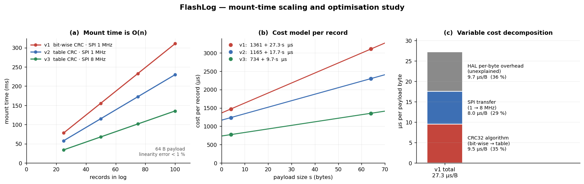
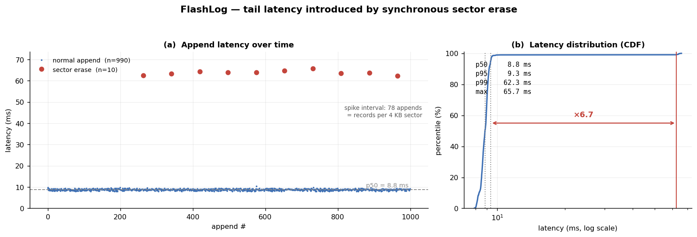

# FlashLog
 
STM32 + FreeRTOS + SPI NOR Flash 上的 append-only 日誌儲存韌體，
具備 CRC32 完整性驗證、斷電自動復原與環形空間回收。
 
 
## 功能
 
- **Append-only log** — record 不跨 sector 邊界，尾端以 PAD record 填補
- **斷電復原** — 開機掃描重建狀態；header 有自己的 CRC-16，壞掉的資料只跳過那個 sector 剩下的部分，不會被當成尾端；換 sector 統一走同一個函式，一律先擦；執行中寫入或擦除失敗就停止寫入，remount 時用同一套規則恢復
- **環形回收** — 寫滿後回收最舊 sector；另提供 STOP 模式（滿了即停、不丟資料）
- **磨損統計** — 各 sector 擦除次數，以 append-only 事件持久化
- **雙 task 架構** — CommandTask / StorageTask 經 queue 分派，flash 為 single-owner
- **Host CLI** — Python 工具支援自動化測試、benchmark 與 CSV 輸出
## 平台
 
| | |
|---|---|
| MCU 板 | STM32 Nucleo-F446RE |
| Flash | SPI NOR 16 MB |
| RTOS | FreeRTOS（CMSIS-RTOS v2） |
| 工具鏈 | STM32CubeMX + STM32CubeIDE |
 
### 接線
 
| Flash | Nucleo（Arduino 排針） |
|---|---|
| VCC | `3V3` |
| GND | `GND` |
| CS | `PWM/CS/D10` |
| DI | `PWM/MOSI/D11` |
| DO | `MISO/D12` |
| CLK | `SCK/D13` |
 
> `DO`→MISO、`DI`→MOSI 是輸出對輸入的交叉接法。
 
## Flash Layout
 
```
0x000000  metadata sector    磨損統計（append-only 事件，4 B/筆）
0x001000  log 區 16 × 4 KB   環形使用，寫滿回收最舊 sector
 
record = header(20 B) + payload(≤64 B)
header = magic | rec_id | length | hcrc | timestamp | crc32
```
 
`hcrc` 是 header 自己的 CRC-16（涵蓋 magic、rec_id、length、timestamp），`crc32` 涵蓋 header 前 16 B 加 payload。

write pointer、最舊／最新 sector、next_id 都不存在 flash 上，開機時掃描推回來：

- **新舊**：每個 sector 第一筆 record 的 rec_id，header 驗得過才拿來排
- **掃描**：header 可信就用 length 跳下一筆；不可信就放棄這個 sector 剩下的部分，從下一個 sector 開頭繼續（record 不跨 sector，sector 開頭一定是 record 的起點）
- **尾端**：只在最新的 sector 找，是最後一筆有效 record 之後，而且從那裡到 sector 結尾都必須是 FF；遇到寫到一半的 record、PAD 或其他資料，就當這個 sector 已滿
- **換 sector**：換 sector、剛好寫滿、開機後的第一筆，全部走 `enter_sector()`：一律先擦，再寫。擦到一半斷電的 sector 可能讀起來全是 FF，但沒擦完，所以不靠「讀起來是不是 FF」判斷
- **空的 log**：沒有任何可信的 record 時從 S0 開始，第一筆寫入前先擦 S0
- 結果：寫進一個 sector 之前，一定是自己擦完的；開機後接著寫的 sector，第一筆可信的 header 就證明當初擦完了

另外兩件和恢復有關的事：

- **開機先等 flash**：reset 鍵、watchdog、重新燒錄都只重置 MCU，flash 可能還在擦。`flash_init()` 先等 WIP 清掉（最多 2 秒）才讓 wear、log 去讀，有等到會印 `[FLSH] busy at boot, waited N ms`。寫入、擦除也改成送指令前先等
- **執行中寫入或擦除失敗**（例如 SPI 逾時）：當成斷電處理，停止寫入，`log remount` 或重開時由 `log_init()` 從 flash 重新判斷位置和編號，不在執行中猜 flash 上寫了多少
 
## 使用
 
序列埠 `115200 8-N-1`：
 
```
FlashLog> help
  id | erase <addr> | write <addr> <text> | read <addr> <len>
  log write <text>       | log read <id>
  log dump [start] [cnt] | log stats
  log format | log remount
  log wear   | log wearreset
  log corrupt | log partial <text>      # 故障注入：payload 壞掉、寫到一半
  log tornhdr | log padcut              # 故障注入：header 寫到一半、換 sector 時 PAD 寫完就斷電
  log fill <count> <len>                # 連續寫入，用來測剛好寫滿、繞一圈
```
 
Host CLI：
 
```bash
pip install pyserial
cd tools
 
python flashlog.py --port COM3 write hello
python flashlog.py dump
python flashlog.py wear
 
# 量測與產圖
python flashlog.py benchmark --count 1000 --size 32 --csv data/latency.csv
python flashlog.py scaling --max 200 --step 25 --csv data/scaling.csv
python plot_gc_latency.py --csv data/gc_latency_full.csv --out ../docs/gc_latency.png
```
 
每個指令的回應皆以 `OK` 或 `ERR <code>` 結尾，供工具判斷完成時機。
 
## 斷電測試（PC 上）

`tools/host_test/` 在 PC 上模擬 NOR flash（寫入只能把 1 變 0、以 4 KB sector 擦除），可以在任何一次寫入或擦除的中途斷電，接著重開機（`wear_init()` + `log_init()`）再檢查。檢查不靠 log.c 自己的判斷：直接在 flash 映像裡找 magic 和 CRC32 都對的 record，和「`log_append` 回傳成功的資料」比對。

另外模擬兩種情況：

- 擦到一半斷電時，有一半的機會讓它讀起來全是 FF（看起來像擦好了）。擦除沒做完的 sector 會被標記，在下一次完整擦除前寫進去就算錯
- 不斷電，但某次寫入或擦除回傳失敗（只做了一部分）。測試程式像一般程式一樣不理會錯誤繼續寫 3 筆，再 remount

```bash
cd tools/host_test
./run.sh            # 測目前的程式
./run.sh ec70b1a    # 另外再測改版前的程式，方便比較
```

| 情境 | 改版前 | 第一版（header CRC） | 目前 |
|---|---|---|---|
| 寫到一半斷電，重開一次 | ✓ | ✓ | ✓ |
| 再重開一次（壞掉那筆還在 flash 上） | ✗ | ✓ | ✓ |
| 中間某筆的 payload 壞掉（位元翻轉） | ✗ | ✓ | ✓ |
| 中間某筆的 header 壞掉 | ✗ | ✓ | ✓ |
| 繞過一圈後，寫到一半斷電 | ✗ | ✓ | ✓ |
| 換 sector 時斷電（PAD 寫完之後） | ✗ | ✓ | ✓ |
| 擦到一半斷電（100 種擦法） | ✗ | ✓ | ✓ |
| 剛好填滿 sector（不是斷電） | ✗ | ✓ | ✓ |
| 擦到一半斷電，讀起來全是 FF | ✗ | ✗ | ✓ |
| format 擦到一半，讀起來全是 FF（log 是空的） | ✗ | ✗ | ✓ |
| 寫入回傳失敗，之後繼續寫 | ✗ | ✗ | ✓ |
| PAD 寫好、擦除回傳失敗，之後繼續寫 | ✗ | ✗ | ✓ |

隨機測試：3000 組 × 30 輪、重開機 90,000 次；斷電 43,356 次（擦除中途 14,895 次，其中 7,365 次讀起來全是 FF），flash 回傳失敗 7,753 次。目前 0 組出錯；第一版 2,853 組出錯；改版前 3000 組都出錯。

開機時 flash 還在忙（MCU 單獨重置）這件事，模擬器測不到，要在板子上驗證（見 `docs/板子驗證步驟.md`）。

## 量測結果
 
數據由韌體端 DWT cycle counter（62.5 ns 解析度）量測，經 host CLI 收集為 CSV。
 
### Mount 成本與優化
 

 
Mount 時間隨 record 數線性成長，成本模型 `t ≈ n × (734 + 9.7s) µs`（s = payload bytes）。
 
兩輪優化將變動成本降低 **64%**（27.3 → 9.7 µs/B）：CRC32 改查表法（−35%）、
SPI 時脈 1→8 MHz（−29%）。剩餘 9.7 µs/B 中實際傳輸僅佔 1 µs，
其餘推測為 HAL 的 per-byte 開銷。
 
### GC 造成的 tail latency
 

 
log 寫滿後量測 1000 次 append（payload 32 B）：
 
| p50 | p95 | **p99** | max | mean |
|---|---|---|---|---|
| 8.82 ms | 9.35 ms | **62.29 ms** | 65.70 ms | 9.34 ms |
 
尖峰來自同步的 sector 擦除（實測 54.9 ms），出現 10 次、**間隔精確為 78 筆**
——正好是一個 4 KB sector 能容納的 record 數（4096 / 52）。
注意 mean 幾乎等於 p50，完全掩蓋了這個長尾。
 
### 磨損分布
 
連續寫入 4000 筆後，16 個 sector 的擦除次數為 5 / 3 兩種值（spread = 2）。
環形回收使擦除嚴格輪序，單次連續運轉下 spread 必然 ≤ 1。
 
## 已知限制
 
- **Mount 為 O(n)** — 1593 筆需 1.86 s；根本解法是建立索引，效能優化只能改善常數項
- **GC 的 62 ms 長尾** — 在飽和寫入下這是硬體邊界；若工作負載有閒置窗口，可用提前擦除迴避，代價是犧牲一個 sector 作為緩衝。
- `log_format` 固定從 S0 開始，反覆 format 會使前段 sector 磨損較快
- **擦除紀錄的壓縮不是斷電安全的** — 先擦掉再重寫，中途斷電會讓擦除次數歸零；壓縮後也只保留相對次數。改法：兩個 sector 輪流，先寫好新的再擦舊的
- **寫入或擦除失敗後，要 remount 才能繼續寫** — 刻意的：失敗後 flash 上寫了多少不確定，交給開機恢復的規則判斷；要不要自動 remount 由上層決定
- **換 sector 一律先擦** — format 後的第一圈，每換一個 sector 也要多等一次擦除（約 55 ms），和繞一圈之後一樣
## 專案結構
 
```
Core/Src/   flash.c  log.c  crc32.c  wear.c  log_uart.c  cmd.c  perf.c  main.c
tools/      flashlog.py（host CLI）  plot_*.py（繪圖）  data/（量測 CSV）
            host_test/（PC 上模擬 NOR flash 的斷電測試）
docs/       量測圖表
```
 
| Tag | 內容 |
|---|---|
| `v0.1-pre-gc` | append-only log、CRC recovery、DWT profiling |
| `v0.2-gc` | 環形回收、磨損統計、tail latency 分析 |
